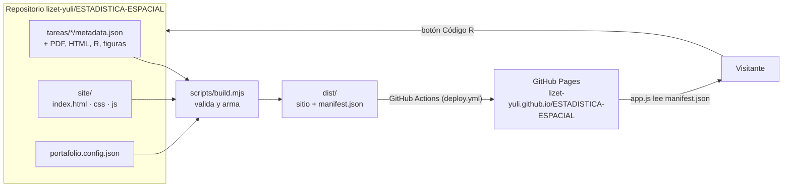

# Plan de arquitectura — Portafolio de Estadística Espacial

## 1. Idea central

El portafolio es un **sitio estático generado a partir de carpetas**. No hay
servidor ni base de datos: cada trabajo es una carpeta con un `metadata.json`,
un script arma el sitio y GitHub lo publica. Agregar un trabajo es crear una
carpeta y hacer `git push`.

Es la misma arquitectura de la página de referencia
(`newneo4/estadistica-espacial`), con el diseño propio de este portafolio
(fondo azul oscuro, acento naranja, tarjetas claras y filtros por tipo de archivo).

## 2. Componentes



| Capa | Dónde | Responsabilidad |
|:--|:--|:--|
| **Contenido** | `tareas/tarea-NN-nombre/` | Los archivos de cada trabajo y su `metadata.json`. Es lo único que se toca al agregar trabajos. |
| **Presentación** | `site/` | Página única: inicio, estadísticas, trabajos y contacto. No contiene trabajos escritos a mano; los dibuja a partir de `manifest.json`. |
| **Construcción** | `scripts/build.mjs` | Lee las carpetas, valida los `metadata.json`, comprueba qué archivos existen, copia todo a `dist/` y genera `manifest.json`. Si un `metadata.json` está mal escrito, se detiene y no publica. |
| **Publicación** | `.github/workflows/deploy.yml` | En cada `push` a `main`: ejecuta el build y publica `dist/` en GitHub Pages. |
| **Configuración** | `portafolio.config.json` | Repositorio y rama a los que apuntan los enlaces a GitHub. En GitHub Actions se toman automáticamente del entorno. |

`dist/` nunca se sube al repositorio: se genera en cada build (está en `.gitignore`).

## 3. Flujo de datos

1. `build.mjs` recorre `tareas/` en orden y convierte cada `metadata.json` en una
   entrada de `manifest.json`, añadiendo lo que se puede deducir: número de tarea
   (del nombre de la carpeta), tipo de cada archivo (de la extensión), si el archivo
   ya está subido y el estado del trabajo.
2. `app.js` descarga `manifest.json` y con él construye las tarjetas, las pestañas
   de unidad, los filtros por tipo (solo los tipos que existen) y las cuatro cifras
   de la sección Estadísticas.
3. Los filtros (unidad + tipo + buscador) se aplican en el navegador, sin recargar.

## 4. Cómo se enlaza con GitHub

Hay tres enlaces distintos:

| Enlace | Cómo funciona | Estado |
|:--|:--|:--|
| **Código → repositorio** | La carpeta local está conectada a `github.com/lizet-yuli/ESTADISTICA-ESPACIAL` (`git remote origin`). Conserva el historial de las tres imágenes que ya estaban subidas. | Hecho |
| **Repositorio → sitio publicado** | `deploy.yml` construye y publica en GitHub Pages en cada `push`. | Listo; falta el primer `push` y activar Pages (sección 5) |
| **Sitio → repositorio** | Los botones GitHub del menú, inicio y pie, y cada botón "Código R", apuntan al repositorio. El código se lee en GitHub con resaltado de sintaxis; los PDF, HTML e imágenes se abren desde el sitio. | Hecho |

## 5. Puesta en marcha (una sola vez)

1. **Subir el proyecto.** En la terminal, dentro de la carpeta:

   ```bash
   git add .
   git commit -m "Reestructurar el portafolio: sitio, build y publicación automática"
   git push -u origin main
   ```

   La primera vez Git abrirá el navegador para iniciar sesión en GitHub.

2. **Activar GitHub Pages.** En el repositorio: *Settings → Pages → Build and
   deployment → Source: **GitHub Actions***.

3. **Publicar.** Pestaña *Actions → Publicar portafolio → Run workflow* (o cualquier
   `push` nuevo). Al terminar, el sitio queda en
   `https://lizet-yuli.github.io/ESTADISTICA-ESPACIAL/`.

4. **Mostrar el enlace.** En la página del repositorio: *About (⚙) → Website →
   "Use your GitHub Pages website"*.

Desde ahí el ciclo es: editar o agregar en `tareas/` → `npm run dev` para revisar →
`git add . && git commit -m "..." && git push`.

## 6. Hoja de ruta

| Fase | Qué incluye | Estado |
|:--|:--|:--|
| **0. Base** | Estructura de carpetas, build con validación, sitio dinámico, servidor local, workflow de publicación, repositorio enlazado | Hecho |
| **1. Publicación** | Primer `push`, activar Pages, comprobar el sitio en línea | Pendiente (sección 5) |
| **2. Contenido** | Foto de perfil (`site/img/avatar.jpg`, hecho); agregar los trabajos retirados cuando tengan sus archivos y completar `fecha` y `unidad` reales de cada uno | En curso |
| **3. Mejoras** | Miniatura para cada trabajo; reportes de R Markdown como HTML; página de detalle por trabajo si alguno necesita más explicación | Opcional |

Trabajos por agregar cuando tengan sus archivos (se retiraron del sitio para no
mostrar tarjetas vacías): Ubicación Espacial, Dashboard de Gestión Lechera,
Variable Aleatoria Gaussiana y Metodología de Jenks. Para **quitar** un trabajo
basta borrar su carpeta en `tareas/` y hacer `push`.

## 7. Decisiones y límites

- **Sin frameworks ni dependencias.** HTML, CSS y JavaScript puros; el build usa solo
  Node.js. No hay `npm install` ni nada que se desactualice.
- **El build falla antes que el sitio.** Un `metadata.json` con error de sintaxis,
  sin título o con fecha mal escrita detiene la publicación y dice en qué archivo
  está el problema; la versión anterior del sitio sigue en línea.
- **Archivos faltantes no rompen nada.** Se muestran como botón gris "pendiente".
- **HTML de R Markdown.** Generarlos autocontenidos (`self_contained: true`, que es
  el valor por defecto) para que el mapa funcione con un solo archivo.
- **Tamaño.** GitHub rechaza archivos de más de 100 MB y el sitio publicado no debe
  pasar de 1 GB. Comprimir los PDF grandes; los datos pesados van como enlace
  externo (`"url"`) en lugar de subirse.
- **El repositorio es público.** No subir datos personales ni bases con restricción
  de uso.
